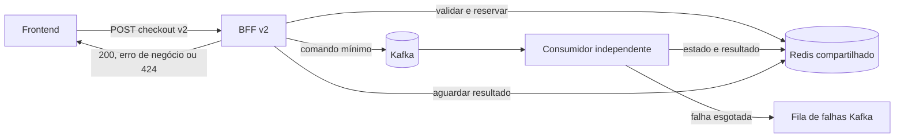

# Arquitetura — checkout v2 com Kafka

## Estado e fontes

Documento de arquitetura baseado em [spec_kafka.md](spec_kafka.md), [spec.md](spec.md), [arquitetura.md](arquitetura.md) e no código atual. A implementação está sendo entregue por iterações; valide os estados e limites registrados em [plano-kafka.md](plano-kafka.md) antes de considerar a solução concluída. As escolhas técnicas deste documento atendem às decisões aprovadas e não são apresentadas como requisitos do PDF.

## Limites

- O pré-checkout e a implementação v1 permanecem inalterados. A rota v2 mantém JSONs e códigos existentes de sucesso e erro de negócio; acrescenta `409 / PAYMENT_IN_PROGRESS` quando já houver uma tentativa v2 em processamento.
- Kafka é assíncrono internamente; o BFF espera o resultado e responde em até cinco segundos, incluindo no máximo dois segundos para confirmação da publicação. Decorrido o limite sem resultado confirmado, retorna o `424` existente de resultado desconhecido.
- A regra de uso determina que cada cliente utiliza somente uma versão. Não existe nesta etapa controle técnico para impor isso; proteção e verificação entre versões ficam para evolução posterior.
- Redis é compartilhado e não persistente. A perda do seu estado elimina as garantias que dependem dele. Um único broker Kafka local não fornece redundância entre brokers, mesmo com `acks=all`.



O BFF aguarda o resultado consultando o estado da tentativa no Redis a cada 100 ms até obter resultado ou atingir o prazo global, conforme escolha do usuário. Consultas devem funcionar com múltiplas instâncias e não ultrapassar o orçamento de cinco segundos. A v1 e o simulador HTTP continuam com os limites descritos em `arquitetura.md`.

## Componentes e interfaces

| Limite | Responsabilidade | Direção da dependência |
| --- | --- | --- |
| API v2 | Receber e validar o contrato público e converter o resultado em HTTP usando os mesmos contratos v1 e o novo conflito v2 | Depende de uma porta de aplicação; não manipula diretamente Kafka ou Redis. |
| Aplicação v2 | Coordenar validação, criação da tentativa, publicação e espera dentro dos prazos | Usa portas de catálogo de carrinho, tentativa, envio e leitura de resultado; não depende do adaptador Kafka. |
| Domínio/simulação | Definir o resultado de cartão/Pix e as transições de negócio a partir do snapshot | Sem dependência do transporte, framework ou detalhes Redis. |
| Repositório de carrinhos | Fornecer o snapshot e proteger a aprovação conforme a spec | Implementação Redis; manter a v1 e sua interface existentes inalteradas. |
| Estado de tentativa | Registrar identidade interna, reserva, posse, contagem, estado e resultado mínimo necessário | Interface de aplicação com adaptador Redis; operações concorrentes necessárias são atômicas. |
| Publicação de comando | Enviar mensagem mínima e identificar confirmação, falha conhecida ou resultado incerto | Interface de aplicação com adaptador Kafka; `acks=all`, confirmação em até dois segundos. |
| Consumidor independente | Validar comando, adquirir/renovar posse, executar simulação e gravar resultado | Adaptador Kafka chama aplicação/domínio por interfaces; confirma offset apenas após estado final ou fila de falhas confirmada. |
| Falhas e operação | Encaminhar mensagens não processáveis e permitir inspeção e intervenção manual | Interface de encaminhamento e ferramentas operacionais a detalhar; sem expor dados sensíveis. |

### Módulos Maven

`checkout-v2-core` concentra modelos v2, portas, `RedisAttemptStore`, `KafkaCommandPublisher` e `PublicationCoordinator`. Não depende do BFF nem contém leitor do payload serializado da v1. O BFF e o worker dependem desse módulo; o worker também depende apenas do classifier `v1-models` do BFF para desserializar o snapshot e conserva nele seu leitor/repositório e os componentes `@KafkaListener` e `@Scheduled`. O BFF declara os beans compartilhados de forma explícita e não faz component scan do pacote do worker, evitando carregar listener ou recuperação agendada e eliminando ciclo Maven.

O deadline HTTP v2 é capturado no filtro da rota antes da leitura/validação MVC e passado à aplicação. As chamadas Redis usam executor limitado e cada etapa verifica o orçamento antes de iniciar; publicação conserva seu limite interno de dois segundos. Uma operação já iniciada pode terminar após a resposta `424`; não se presume que timeout a tenha cancelado. A factory Kafka do BFF é específica da v2 e fixa `acks=all`, idempotência, `linger.ms=0`, `request.timeout.ms=1500`, `delivery.timeout.ms=2000` e `max.block.ms=2000`, sem alterar a configuração de transporte da v1.

## Fluxo e invariantes

1. A API v2 valida a mesma entrada da v1, verifica carrinho e meio conforme snapshot e solicita a criação de uma tentativa interna.
2. A criação de tentativa e o controle de concorrência v2 usam operações atômicas; uma segunda chamada v2 enquanto a primeira estiver ativa recebe `409 / PAYMENT_IN_PROGRESS`.
3. O BFF publica o comando mínimo. A confirmação tem limite próprio de dois segundos; o orçamento global da chamada é de cinco segundos, incluindo publicação e espera. Se o resultado for incerto, a resposta usa o `424` original e não declara que o pagamento foi cancelado.
4. O consumidor independente valida a mensagem e a tentativa, adquire uma posse válida e executa a regra do pagamento. O estado e o resultado devem permitir que o BFF responda no contrato original. Como o consumidor não recebe o cartão completo, usa somente `lastDigits` para a simulação e o snapshot para valor e produtos.
5. Uma aprovação e a gravação do resultado precisam impedir reaprovação ou execução tardia sob posse antiga. Uma recusa permite nova tentativa; uma reentrega da tentativa antiga não cria uma nova. A confirmação do offset ocorre somente após resultado registrado ou encaminhamento confirmado à fila de falhas.
6. Se o resultado vier após o prazo HTTP, ele continua sujeito às mesmas regras de estado; `424` não garante que a mensagem não tenha sido processada.

Os estados técnicos internos da tentativa v2 são `AGUARDANDO_PUBLICACAO`, `PUBLICADO`, `PROCESSANDO`, `APROVADO`, `RECUSADO` e `INTERVENCAO`. Ficam em chaves Redis próprias da v2, sem alterar o estado ou o JSON da v1. A confirmação de publicação, a posse e as contagens devem ser representadas de modo a lidar com eventos concorrentes: por exemplo, uma confirmação tardia de publicação não pode regredir uma tentativa já em processamento ou concluída. A identidade interna deve distinguir uma mensagem reentregue de uma nova tentativa após recusa, sem pressupor que `cartId` sozinho identifica uma operação.

### Transições e coordenação da tentativa v2

O estado representa o acompanhamento da tentativa, enquanto confirmação de publicação, contadores, prazo e posse são informações distintas. Uma confirmação de publicação pode chegar após o consumidor começar ou terminar: atualizar essa confirmação não pode substituir `PROCESSANDO`, `APROVADO`, `RECUSADO` ou `INTERVENCAO` por `PUBLICADO`.

| Evento | Condição e efeito atômico esperado |
| --- | --- |
| Criar tentativa | Verificar que não existe outra tentativa v2 ativa para o carrinho; criar identificador, comando mínimo, estado `AGUARDANDO_PUBLICACAO` e vínculo com o carrinho. Se existir tentativa ativa, responder `409`. |
| Reservar publicação | Verificar elegibilidade, limite e intervalo; incrementar a contagem antes de enviar e atualizar o índice de recuperação na mesma operação. Um envio que não comece após a reserva ainda consome a contagem. |
| Confirmar publicação | Registrar a confirmação; avançar para `PUBLICADO` somente se o estado ainda for `AGUARDANDO_PUBLICACAO`. A confirmação não reabre estado terminal ou em intervenção. |
| Iniciar ou retomar consumo | Verificar tentativa e comando; obter posse única por 30 segundos e mudar para `PROCESSANDO`. Uma posse ativa impede aquisição concorrente; uma posse vencida permite retomar somente a mesma tentativa. |
| Renovar posse | A cada 10 segundos, estender a validade somente se o identificador ainda for o atual e a tentativa estiver apta a processar. A perda da posse impede conclusão. |
| Iniciar execução | Sob posse válida, verificar limite e registrar a contagem antes de executar; respeitar o intervalo de um segundo entre execuções. |
| Concluir | Verificar posse atual e ausência de intervenção; gravar resultado e `APROVADO` ou `RECUSADO` atomicamente. Uma recusa libera a criação de outra tentativa; reentrega da tentativa concluída apenas confirma o offset. |
| Esgotar publicação | Se não houver resultado terminal, registrar `INTERVENCAO`, invalidar posse e retirar a tentativa da recuperação automática na mesma operação. Se o resultado já foi registrado, preservá-lo. |
| Esgotar processamento | Registrar a condição de intervenção e encaminhar à fila de falhas; não executar uma quarta vez automaticamente. Se não houver confirmação da fila de falhas, manter o offset original sem confirmação. |
| Autorizar novo ciclo | Ação operacional explícita para a mesma tentativa, com os contadores do ciclo correspondente reiniciados atomicamente e sem reabrir resultado terminal. Não pressupor publicação única na fila de falhas. |

O índice de recuperação e as mudanças relacionadas do estado são atômicos. A verificação agendada ocorre a cada segundo, mas a elegibilidade exige 30 segundos entre envios, confirmação de estado no Redis e ausência de processamento ativo ou intervenção. O primeiro envio participa do limite de três. A expiração da posse não exclui tentativa, resultado ou vínculo com carrinho; não há expiração automática dos registros.

O pré-checkout e a v1 usam `checkout:cart:<cartId>`. A v2 consulta o carrinho existente para obter o snapshot e registra sua aprovação somente em chaves próprias, sem alterar o estado desse carrinho ou o código v1. O vínculo de aprovação v2 por carrinho deve permanecer após o término da tentativa e ser consultado atomicamente antes de criar outra tentativa v2; a recusa não cria esse vínculo. Se um mesmo carrinho for usado na v1 depois de aprovado na v2, a v1 não verá essa aprovação. Essa é uma limitação aceita da premissa de exclusividade, não uma proteção entre versões.

### Modelo Redis e operações

O desenho usa Redis isolado compartilhado, como no Compose atual; não pressupõe Redis Cluster. Estes nomes são escolhas técnicas locais, não fazem parte do contrato HTTP:

| Chave | Tipo | Conteúdo |
| --- | --- | --- |
| `checkout:v2:cart:<cartId>` | hash | Identificador da tentativa ativa, quando houver, e identificador da tentativa aprovada, quando houver. |
| `checkout:v2:attempt:<attemptId>` | hash | `cartId`, comando mínimo, estado, confirmação e contagem de publicação, contagem de execução, prazo de posse, identificador da posse, momento da próxima execução ou publicação, motivo de intervenção e resultado permitido. |
| `checkout:v2:publication-due` | conjunto ordenado | Identificadores de tentativas com publicação sem confirmação; pontuação é o instante em que se tornam elegíveis. |

As chaves não incluem número completo de cartão ou CVV e não têm TTL automático. A posse é um prazo registrado na tentativa, não a expiração da chave. Usar horário do Redis nas comparações compartilhadas evita depender da sincronização entre relógios das instâncias; usar relógio monotônico local apenas para limitar a espera HTTP.

As operações abaixo são portas de aplicação implementadas com scripts Lua Redis, incluindo as alterações no índice; cada script recebe explicitamente as chaves envolvidas. A aplicação não deve separar uma verificação de sua gravação em comandos independentes:

1. **Criar:** verificar aprovação e tentativa ativa da v2; criar tentativa e vínculo ativo, e indexar recuperação, em uma única operação. Validar a existência do carrinho e seu snapshot conforme a spec, sem escrever na chave v1. Se a criação tiver resultado incerto, não publicar sem antes confirmar a tentativa registrada.
2. **Reservar envio:** verificar tentativa, confirmação, intervenção, limite, instante elegível e ausência de posse ativa; incrementar contador e agendar próxima elegibilidade antes da chamada ao produtor. A operação concorrente vencedora é a única autorizada a enviar naquela reserva. O envio inicial usa a mesma regra de contagem, sem aguardar 30 segundos.
3. **Registrar confirmação:** registrar confirmação e remover a entrada do índice; atualizar o estado para `PUBLICADO` somente se ainda estiver aguardando publicação. Uma confirmação atrasada não remove intervenção nem altera resultado terminal.
4. **Adquirir e renovar posse:** adquirir apenas para tentativa válida, sem posse vigente e sem intervenção; gravar token único e prazo de 30 segundos. A renovação compara token e prazo válidos e estende a posse; após vencimento ou invalidação, o processo antigo não a recupera pelo mesmo token.
5. **Contar execução:** sob posse válida, verificar contagem e horário elegível, incrementar antes da execução e registrar o próximo horário permitido. A queda após incremento consome a execução.
6. **Concluir:** verificar token, prazo e ausência de intervenção; gravar resultado e estado terminal; retirar vínculo ativo e índice de publicação. Em aprovação, gravar também o vínculo de aprovação v2 por carrinho na mesma operação; em recusa, não gravá-lo. Assegurar que a tentativa continua sendo a ativa antes de alterar o vínculo.
7. **Marcar intervenção:** verificar se não existe resultado terminal; registrar motivo, invalidar posse e retirar do índice de recuperação. A tentativa continua vinculada ao carrinho para preservar o `409`. A operação concorre atomicamente com a conclusão.
8. **Autorizar ciclo:** verificar intervenção, mesma tentativa ativa e ausência de resultado terminal; registrar a autorização explícita, zerar somente o contador pertinente e restabelecer a elegibilidade do ciclo apropriado. O procedimento de processamento deve garantir que exista uma mensagem segura para reprocessar, sem criar uma nova intenção de pagamento.

Na leitura do índice, várias instâncias podem encontrar a mesma tentativa: apenas o script de reserva decide quem pode enviar. Resultados desconhecidos de scripts não autorizam repetir efeitos às cegas; consultar estado antes de agir. Se a perda de conexão impedir confirmar o estado, manter o resultado como incerto conforme a spec.

### Tópicos, offsets e intervenção

Usar dois tópicos configuráveis: `checkout-v2-commands` para comandos mínimos e `checkout-v2-failures` para falhas; a chave Kafka do comando é `cartId`, e a deduplicação é pelo `attemptId` no Redis. Esses nomes são configuração interna e não modificam a API. No ambiente local, usar um broker e documentar a ausência de redundância.

**Versões e execução local:** usar `apache/kafka:4.2.2` em modo KRaft, um broker/controlador, tópicos criados explicitamente com uma partição e fator de replicação 1 e `min.insync.replicas=1`; não habilitar criação automática de tópicos. Usar Spring Kafka `4.1.2` e cliente Kafka `4.2.2` gerenciados pelo BOM Spring Boot `4.1.2` já instalado no projeto, e Testcontainers `2.0.5` já fixado no POM. O broker local não fornece redundância e a perda de dados do Redis continua fora das garantias. A [Apache confirma a imagem 4.2.2](https://kafka.apache.org/42/getting-started/docker/) e recomenda `KAFKA_OPTS=-XX:-UseBASE64Intrinsics` para a imagem JVM afetada; aplicar a configuração no Compose e nos contêineres de teste conforme o [aviso oficial](https://kafka.apache.org/blog/2026/11/19/mitigating-cve-2026-114938-java4shell-in-apache-kafka-deployments/). A compatibilidade efetiva e a disponibilidade da imagem devem ser verificadas por testes antes de declarar a solução operacional.

**Retenção:** ambos os tópicos usam `cleanup.policy=delete`, `retention.ms=604800000` (sete dias) e `retention.bytes=-1`, escolha aprovada pelo usuário. A remoção ocorre por segmentos e não precisa acontecer exatamente no instante do limite. Após a retenção, o comando ou a evidência da fila de falhas pode não estar mais disponível no Kafka; sem estado e evidências suficientes, não presumir que uma intervenção ou recuperação seja possível. Essa retenção independe da ausência de expiração automática dos registros no Redis.

**Produtor:** `acks=all`, idempotência do produtor habilitada, `linger.ms=0`, `request.timeout.ms=1500`, `delivery.timeout.ms=2000` e `max.block.ms=2000`. A contagem aprovada corresponde a chamadas da aplicação, não aos retries internos do cliente Kafka. Os dois segundos são um deadline monotônico único para a chamada de envio **e** a espera pela confirmação, não dois prazos consecutivos. Como `send` pode bloquear, executá-lo em recurso limitado que não bloqueie o encerramento HTTP; timeout não prova cancelamento do envio. Não iniciar nova chamada de envio fora da reserva atômica e do intervalo definidos. A publicação da fila de falhas exige confirmação antes de confirmar o offset original.

**Consumidor:** usar grupo configurável `checkout-v2-worker`, `enable.auto.commit=false` e processamento sequencial por partição. Quando o grupo não tiver offset, ler desde o início para não perder comandos já publicados. Pausar a partição enquanto um registro aguarda retry ou confirmação da fila de falhas e continuar o polling necessário para manter o grupo; nunca confirmar offset posterior que ultrapasse registro não resolvido. Essa configuração não substitui a deduplicação no Redis.

Desabilitar confirmação automática de offsets. Confirmar o offset somente após o resultado estar registrado ou o encaminhamento à fila de falhas estar confirmado. Por partição, uma mensagem com encaminhamento ainda não confirmado impede confirmar um offset posterior que a ultrapasse; reentregas e duplicatas devem ser seguras. Mensagem inválida encaminha apenas tópico, partição, offset e motivo, sem corpo desconhecido. Para mensagens válidas, o procedimento operacional deve usar somente dados mínimos permitidos e identificar tentativa e motivo; não depender da existência de dados Redis após sua perda.

A ferramenta operacional da v2 será o próprio executável do consumidor em modo CLI, sem iniciar listeners nem recuperação agendada. A interface planejada, a implementar e testar, é:

```text
docker compose run --rm worker inspect --attempt-id <uuid>
docker compose run --rm worker authorize-publication --attempt-id <uuid>
docker compose run --rm worker authorize-processing --attempt-id <uuid>
docker compose run --rm worker mark-intervention --attempt-id <uuid> --failure-partition <n> --failure-offset <n>
docker compose exec kafka /opt/kafka/bin/kafka-console-consumer.sh --bootstrap-server localhost:9092 --topic checkout-v2-failures --from-beginning --property print.partition=true --property print.offset=true
```

`inspect` mostra somente identificadores, estado, contadores, posse e motivo seguro. Os comandos de autorização operam por scripts atômicos, recusam tentativa ausente ou terminal e produzem saída e código de processo explícitos; não expõem corpo de cartão. `authorize-publication` inicia um ciclo de publicação aprovado após esgotamento de publicação. Quando o esgotamento foi de processamento, a publicação já esgotou seus três envios, portanto `authorize-publication` é uma autorização explícita prévia do novo orçamento e mantém o estado em intervenção; em seguida `authorize-processing` reinicia o contador de execução, reabre e republica a mesma tentativa. `authorize-processing` pode operar sem a primeira etapa enquanto ainda houver orçamento de publicação. O comando de inspeção Kafka é de leitura e pode mostrar duplicatas. Para mensagens inválidas, usar tópico, partição, offset e motivo para análise, sem republicar automaticamente corpo desconhecido. A CLI usa o perfil `worker-cli`, que não inicia listener nem scheduler.

Quando Redis estiver indisponível, o worker deixa a mensagem de origem pendente e não envia à DLT. Ao atingir o limite local de verificações, cada redelivery tenta resolver o estado antes de qualquer processamento. Para comando correspondente a tentativa ativa, grava `INTERVENCAO/REDIS_UNAVAILABLE` por Lua, que verifica o vínculo/estado, preserva resultado terminal, invalida posse e remove o índice de recuperação; só depois publica metadados à DLT. Se a tentativa já estiver em intervenção, repete apenas o encaminhamento. Resultado terminal completo é preservado e permite confirmar a origem sem DLT. Estado ausente, corrompido, terminal incompleto ou comando divergente não autoriza pagamento nem altera outra tentativa; esses casos são encaminhados somente com metadados seguros. Se a leitura ou mutação Redis falhar ou tiver resposta incerta, manter a origem pendente até redelivery. O contador local pode reiniciar após reinício do consumidor.

Na intervenção de processamento, a autorização viabiliza o reenvio do comando mínimo da mesma tentativa, obtido do Redis, mesmo se o offset original já tiver sido confirmado após a fila de falhas. Se o orçamento de publicação também esgotou, `authorize-publication` precisa ser executado explicitamente antes de `authorize-processing`; cada ciclo continua limitado a três envios. Se o comando ou tentativa não estiverem disponíveis, não recriar estado nem autorizar processamento; sinalizar a limitação operacional. Na intervenção de publicação, `authorize-publication` inicia o novo ciclo de até três envios. Em ambos os casos, mensagens antigas e novas permanecem sujeitas à mesma posse e deduplicação.

O snapshot atual do carrinho é armazenado pela v1 como objeto Java serializado em `payload`, com as classes aninhadas de `br.com.globo.checkout.bff.domain.Models`. O Maven do BFF publicará um artefato adicional com classifier `v1-models`, contendo somente `Models.class` e suas classes aninhadas, gerado em `process-classes`; o consumidor dependerá desse artefato somente para leitura compatível. Isso acrescenta configuração de build, sem mover ou alterar as classes, lógica ou repositório v1; o consumidor converte imediatamente o objeto lido para seu modelo próprio. O adaptador usa a mesma decodificação Base64 e desserialização empregadas pelo repositório atual. Testar o reactor Maven e criar um carrinho pelo pré-checkout existente para leitura pelo processo consumidor real; não pressupor JSON. A desserialização só aceita conteúdo proveniente do Redis configurado do projeto e deve usar filtro restritivo às classes necessárias, sem alterar a desserialização v1.

### Espera HTTP e recuperação operacional

O prazo de cinco segundos começa na entrada do processamento da solicitação v2 e inclui validação, publicação e consultas. Cada espera por publicação ou Redis usa somente o orçamento restante; a publicação tem teto adicional de dois segundos. Consultar Redis a cada 100 ms e encerrar ao receber resultado ou esgotar o prazo. Um `424` não cancela processamento em andamento; o resultado posterior segue as regras de tentativa e de recuperação já aprovadas. A implementação deve testar também atrasos das dependências e indisponibilidade do Redis, não apenas o intervalo entre consultas.

Operadores localizam tentativas em `INTERVENCAO` pelo identificador fornecido nos logs estruturados e mensagens da fila de falhas pelos metadados seguros; identificam se houve esgotamento de publicação ou processamento, inspecionam a causa e autorizam explicitamente o ciclo apropriado da mesma tentativa. Mensagem inválida contém somente tópico, partição, offset e motivo; sua análise e correção precedem qualquer reprocessamento. A CLI operacional implementa esses comandos sem iniciar listener/scheduler e não pressupõe persistência do Redis ou confirmação única do Kafka.

### Pontos de falha a verificar

| Ocorrência | Comportamento exigido |
| --- | --- |
| Queda após criar tentativa e antes de enviar | Recuperação agendada após elegibilidade, com mesmo comando e identificador, respeitando contagem e intervalos. |
| Confirmação de envio perdida | Não presumir que Kafka rejeitou a mensagem; deduplicar reentregas e evitar reenvio enquanto houver processamento ativo. |
| Queda após registrar execução e antes do resultado | A execução contada não é recuperada; após vencer a posse, retomar a mesma tentativa somente se o limite permitir. |
| Resultado gravado e offset não confirmado | Reentrega reconhece resultado terminal e confirma offset sem nova execução. |
| Esgotamento de publicação concorre com conclusão | A operação atômica que vencer determina o resultado: intervenção e posse invalidada, ou resultado terminal preservado. |
| Redis indisponível ou perdeu estado | Não recriar tentativa nem processar sem estado. Enquanto Redis estiver indisponível, manter a origem pendente e não enviar DLT; após a redelivery e quando Redis responder, persistir `INTERVENCAO/REDIS_UNAVAILABLE` com fencing antes de encaminhar a DLT. Se a leitura ou mutação continuar incerta, manter a origem pendente. Sem prometer recuperação após perda do estado. |
| Fila de falhas indisponível | Não confirmar o offset original e não executar novamente além do limite; sinalizar e repetir o encaminhamento. |

### Encaminhamento à fila de falhas

A fila de falhas recebe metadados depois que a intervenção está persistida ou quando o worker confirma que não há estado seguro a modificar (estado ausente/corrompido, terminal incompleto ou comando divergente). Se a publicação ou a confirmação DLT falhar, a mensagem original continua sem confirmação e a redelivery só repete o encaminhamento; não executa pagamento. O worker não consome DLT para reconciliar Redis nem mantém checkpoint da fila de falhas. A origem não é confirmada até o broker confirmar o encaminhamento, salvo quando já existe resultado terminal completo, que é preservado. Essa ordem evita depender de uma transação entre Kafka e Redis; a confirmação Kafka pode se perder e causar duplicata DLT, permitida pela especificação. Se uma mutação Redis retorna resultado incerto, a decisão não assume sucesso: a redelivery consulta o estado compartilhado antes de qualquer nova ação.

Essas invariantes descrevem o desenho proposto, não evidenciam funcionamento da implementação. A verificação com Redis e Kafka reais está distribuída por iteração no plano.

## Posse, falhas e dados

- Reserva v2: posse de 30 segundos, renovação a cada 10; cada aquisição usa um identificador único, e o término compara atomicamente esse identificador e o prazo com a posse atual. A expiração permite retomar somente a mesma tentativa e não apaga seu registro.
- Tentativas e resultados não expiram automaticamente enquanto Redis preservar seus dados. Um índice ordenado pelo horário da próxima recuperação permite localizar pendências; atualizações do índice e do estado são atômicas, conforme as operações descritas acima.
- Contar atomicamente no Redis antes de cada execução: até três por ciclo, com um segundo entre elas. Esgotamento encaminha à fila de falhas e aguarda intervenção; falha de publicação na fila impede confirmação do offset original e não autoriza uma quarta execução automática enquanto o estado estiver preservado. Reprocessamento manual autorizado inicia novo ciclo da mesma tentativa.
- Redis indisponível: fazer até três verificações locais, sem pagamento; se continuar indisponível, manter a origem pendente e aguardar redelivery, sem publicar DLT. Quando Redis voltar, persistir atomicamente `INTERVENCAO/REDIS_UNAVAILABLE` para tentativa ativa correspondente, invalidando posse, antes de encaminhar à DLT. Se a leitura ou mutação for incerta, manter a origem pendente; o contador local pode reiniciar após reinício do worker. Mensagem inválida vai diretamente à fila de falhas apenas com tópico, partição, offset e motivo seguros. Mensagem sem estado necessário não recria carrinho ou tentativa.
- Segredo, log, comando, fila de falhas e persistência não podem conter PAN completo ou CVV. A mensagem Kafka só inclui os dados estabelecidos pela spec. O resultado armazenado não pode incluir dados de cartão além dos necessários ao contrato de sucesso.
- Se o Redis perder seus dados, não afirmar recuperação de carrinhos, resultados ou deduplicação. A publicação no Kafka e a gravação no Redis não formam uma transação única; mapear as falhas entre essas etapas e suas consequências antes de implementar.

## Verificações obrigatórias

1. Confirmar por testes a compatibilidade das versões definidas e executar o Compose local.
2. Implementar e executar os comandos operacionais planejados, incluindo inspeção e autorização dos ciclos e reprocessamento seguro.
3. Comprovar operações atômicas, prazo HTTP, falhas, offsets e limites por meio das validações do plano. Qualquer lacuna que exija novo comportamento público será submetida ao usuário.

## Verificação

Validar cada etapa do [plano-kafka.md](plano-kafka.md) antes da próxima; o encerramento exige testes de contrato v1/v2, resultado tardio e prazos, concorrência v2, publicação incerta, redelivery, limite de execução, fila de falhas, queda e retomada, dados sensíveis e fluxo completo com Kafka e Redis reais. A verificação entre versões e o safeguard de exclusividade de cliente não fazem parte desta etapa.

## Limitação aceita — nova chamada após 424

Sem chave fornecida pelo frontend ou endpoint de consulta, o BFF não recebe uma indicação inequívoca de que uma nova chamada é a repetição da operação anterior ou uma nova intenção de pagamento. O comportamento proposto — `409 / PAYMENT_IN_PROGRESS` enquanto a tentativa estiver ativa, `409 / PAYMENT_ALREADY_APPROVED` se o carrinho já tiver sido aprovado e possibilidade de nova tentativa após recusa — preserva a proteção contra uma segunda aprovação no fluxo v2 enquanto o estado necessário estiver preservado, mas não recupera para o cliente o corpo de sucesso da tentativa anterior nem necessariamente a recusa que ocorreu após o `424`. Uma chamada posterior após recusa pode iniciar outra execução.

O usuário escolheu manter o contrato atual e documentar que o resultado anterior pode não ser recuperável. A nova chamada recebe `409 / PAYMENT_IN_PROGRESS` enquanto a tentativa v2 estiver ativa, o `409 / PAYMENT_ALREADY_APPROVED` existente após aprovação e poderá iniciar nova tentativa após recusa. Não se deve declarar idempotência de requisições HTTP com recuperação integral do resultado apenas com base no identificador interno da mensagem.

O usuário decidiu que, se o BFF cair após registrar a tentativa e a publicação não estiver confirmada, haverá recuperação automática após 30 segundos, alinhados à reserva. Essa decisão substitui a escolha anterior de depender exclusivamente de uma nova chamada do cliente. A recuperação aplica-se somente a publicação não confirmada, sem reabrir tentativas concluídas ou esgotadas. O desenho técnico deve compatibilizar a recuperação com o `409` imediato enquanto a tentativa estiver ativa e com a impossibilidade de identificar a intenção do cliente pela requisição.

Uma nova chamada pode sinalizar a recuperação **da tentativa interna já registrada**, sem substituí-la pelos dados da nova requisição: responder `409` conforme contrato e, se a publicação ainda não estiver confirmada, permitir o reenvio seguro do mesmo comando mínimo e `attemptId`. A recuperação automática também poderá ocorrer após 30 segundos, sem chamada do cliente. Guardar no Redis, junto à tentativa, apenas o comando mínimo aprovado para Kafka: identificadores, meio e quatro últimos dígitos para cartão, sem número completo nem CVV. A reserva e a deduplicação devem impedir segunda aprovação mesmo se a primeira publicação tiver ocorrido; o desenho deve demonstrar que a decisão de republicar é concorrente e atomicamente controlada. Isso não é prova de implementação nem garantia de recuperação após perda do Redis e não presume que a nova requisição seja a mesma operação de negócio. Tentativas na fila de falhas continuam aguardando intervenção, e chamadas durante esse período recebem `409` sem iniciar outra cobrança.

A publicação tem até três tentativas no total, incluindo o envio inicial, com intervalo de 30 segundos. Cada chamada da aplicação ao produtor conta como uma tentativa; reenvios internos da biblioteca dentro do limite de confirmação de dois segundos devem ser documentados. Registrar a contagem no Redis antes de cada envio, inclusive o inicial; uma queda após o registro consome a tentativa. Se a confirmação não for obtida após esgotamento, sinalizar, exigir intervenção operacional e manter `409` para novas chamadas até intervenção. Enquanto Redis estiver indisponível, não reenviar sem confirmar o estado compartilhado; também não reenviar enquanto o consumidor estiver processando. O consumidor Kafka independente verifica pendências a cada segundo por agendamento próprio com coordenação atômica no Redis; não pode depender de receber uma mensagem Kafka para descobrir uma publicação que nunca chegou ao broker. Uma nova chamada pode acionar recuperação somente se os limites de tempo e contagem permitirem, mantendo a resposta `409`.

Se uma mensagem chegar depois de a tentativa ser marcada como publicação esgotada, não executar o pagamento: encaminhar à fila de falhas e manter a tentativa bloqueada. Se o consumidor já tiver começado, a marcação de esgotamento deve invalidar sua posse e impedir a conclusão, exigindo intervenção. Se o resultado já foi registrado atomicamente antes do esgotamento, não desfazê-lo. A conclusão e a marcação de esgotamento devem ser coordenadas atomicamente; o desenho deve especificar e testar ambos os lados dessa corrida. Após análise, o operador pode autorizar novo ciclo de até três envios da mesma tentativa e `attemptId`, preservando a deduplicação. Mensagem não confirmada já processada não deve reabrir uma tentativa concluída.
