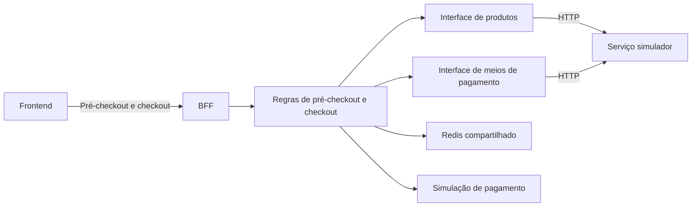

# Arquitetura do BFF de checkout de assinaturas

## Estado e fontes

Documento de trabalho baseado em [spec.md](spec.md) e no desafio `CKW-Desafio Backend-141026-171112 3 (1).pdf`. As regras e contratos são definidos na spec; este documento organiza suas implicações arquiteturais. Onde a spec não define uma solução, a decisão é registrada como pendente até ser tomada em conjunto.

## Objetivo e limites

O BFF atende às telas de pagamento, sucesso e erro de um checkout de assinaturas. Ele recebe a seleção de produtos no pré-checkout, obtém produtos e meios de pagamento por interfaces próprias, cria o carrinho e, no checkout, simula a cobrança. O BFF não é a fonte dos produtos ou dos meios de pagamento, e não integra um gateway real.

O frontend e os serviços de produtos e de meios de pagamento são consumidores ou dependências do BFF. O desafio permite que esses serviços sejam simulados no próprio projeto. A implementação deve manter separados o BFF, os clientes das dependências e as regras do checkout.

O diagrama expressa responsabilidades e dependências lógicas. BFF e simulador são aplicações em módulos Maven separados; os limites concretos de classes e pacotes ainda precisam ser definidos.

## Decisões já tomadas

| Decisão | Origem e motivo |
| --- | --- |
| Usar Java 21 com Spring Boot 4.1.2. | Escolha do usuário para este projeto; Spring Boot é um diferencial opcional do desafio. A [documentação oficial](https://docs.spring.io/spring-boot/system-requirements.html) informa compatibilidade da versão 4.1.2 com Java 21. |
| Usar um serviço HTTP simulador para produtos e meios de pagamento. | Escolha do usuário; o BFF acessará as duas funções por suas interfaces próprias. |
| Usar Redis compartilhado sem persistência de carrinhos e cobrir múltiplas instâncias. | Escolha do usuário, que substitui a opção inicial de memória local e permite compartilhar o estado entre processos. Se o Redis reiniciar sem persistência, os carrinhos são perdidos; reiniciar apenas uma instância do BFF não implica perdê-los. |
| Usar Maven com Maven Wrapper. | Escolha do usuário para construção reproduzível do projeto. |
| Organizar BFF e simulador HTTP em dois módulos Maven no mesmo repositório. | Escolha do usuário para separar as aplicações mantendo a entrega reunida. |
| Expor `GET /products/{slug}` e `GET /payment-methods` no simulador. | Escolha do usuário; o BFF usa URLs configuráveis e mantém interfaces próprias para os clientes. O produto encontrado retorna `200` e o objeto de produto da spec; slug inexistente retorna `404` sem corpo; meios retornam `200` e `{ "paymentMethods": [...] }` com os campos da spec. |
| Usar script Lua no Redis para a operação atômica de aprovação do carrinho. | Escolha do usuário para impedir aprovações concorrentes entre instâncias. |
| Retornar HTTP `424`, `DEPENDENCY_UNAVAILABLE` e `S-1001` quando o Redis estiver indisponível. | Escolha do usuário para reutilizar o contrato de erro de dependência. A falha após envio de uma operação ao Redis segue a regra de resultado desconhecido abaixo. |
| Se o resultado da operação no Redis for desconhecido, retornar HTTP `424` informando a incerteza. | Escolha do usuário: uma tentativa posterior consulta o estado e não reaplica uma aprovação confirmada. |
| Usar JUnit, Mockito e Testcontainers para testes com Redis real em contêiner isolado. | Escolha do usuário para verificar as regras e a concorrência com a dependência real. |
| Testar timeout e falhas HTTP com servidor controlado nos testes. | Escolha do usuário; o simulador entregue não expõe endpoints próprios para provocar falhas. |
| Testar resultado desconhecido no Redis com proxy controlado. | Escolha do usuário para cobrir tanto a operação aplicada quanto a não aplicada após perda de comunicação. |
| Separar o BFF em pacotes de API, aplicação/regras, domínio e infraestrutura. | Escolha do usuário para tornar explícitas as responsabilidades, incluindo clientes HTTP e Redis na infraestrutura. |
| Usar Docker Compose para execução local e Redis isolado em contêiner nos testes. | Escolha do usuário para executar os componentes e exercitar a integração. |
| Registrar eventos e falhas sem corpos de requisição ou resposta nem dados de cartão; incluir `cartId` quando disponível. | Escolha do usuário para permitir diagnóstico sem expor informações sensíveis. |
| Simular pagamentos, sem gateway real. | Exigência da spec e do desafio; o sistema serve para demonstrar os fluxos. |
| Manter produtos, preços e meios retornados associados ao carrinho. | Decisão da spec para usar no checkout os dados apresentados no pré-checkout. |
| Manter o carrinho pendente após recusa e aprovado após sucesso, sem expiração automática. | Decisão da spec para permitir nova tentativa e impedir novo pagamento após aprovação. |
| Usar cálculo decimal exato; apresentar valores em reais como números JSON e moeda BRL. | Decisão da spec para evitar erros de arredondamento. |
| Limitar cada consulta de produtos ou meios a dois segundos, sem retry automático ou fallback. | Decisão da spec; falhas de dependência recebem `DEPENDENCY_UNAVAILABLE`. |

## Fluxos e responsabilidades

### Pré-checkout

1. `POST /operations/pre-checkout` recebe uma lista não vazia de produtos identificados por slug e valida a entrada, incluindo a rejeição de slugs repetidos.
2. O BFF obtém os dados dos produtos e dos meios de pagamento por suas interfaces. Produtos inexistentes geram o erro previsto na spec. Se qualquer consulta necessária falhar, atingir o timeout ou retornar resposta inválida, nenhum carrinho é criado.
3. O sistema associa ao novo carrinho os produtos, preços e meios retornados; o carrinho começa em `PENDENTE`.
4. A resposta HTTP `200` retorna `cartId`, `products` e `paymentMethods`, conforme o contrato da spec.

### Checkout

1. `POST /operations/checkout` recebe o carrinho e o meio escolhido. O sistema valida a entrada, a existência do carrinho e se o meio pertence à lista associada a ele.
2. O pagamento é simulado com o valor calculado a partir dos produtos associados ao carrinho. Cartão terminado em `0002` é recusado; os demais cartões que passam nas validações da spec e Pix são aprovados.
3. Na recusa, o carrinho permanece `PENDENTE` e pode receber nova tentativa. Na aprovação, passa a `APROVADO`; tentativas posteriores retornam erro de pagamento duplicado.
4. O sucesso retorna HTTP `200`, os dados do pagamento e dos produtos conforme a spec. Cartão retorna `lastDigits`; Pix retorna `pixCode` simulado. O número completo do cartão e o CVV não são persistidos nem retornados.

### Concorrência

A verificação do estado e a transição para aprovado devem ocorrer atomicamente por script Lua no Redis compartilhado, de modo que requisições concorrentes, inclusive em instâncias distintas do BFF, não aprovem o mesmo carrinho mais de uma vez. A implementação deve preservar a possibilidade de nova tentativa após recusa.

Se a conexão cair após o envio da operação e o BFF não souber se ela foi executada, a resposta é HTTP `424` e informa que o resultado é incerto. Uma tentativa posterior consulta o estado compartilhado e não reaplica uma aprovação confirmada. O `424` nesse caso não garante que a operação não ocorreu; ela pode ter sido concluída antes da perda de conexão.

Como o Redis foi escolhido sem persistência de carrinhos, a garantia entre instâncias depende da disponibilidade e preservação do estado no Redis compartilhado. Após perda desse estado, um `cartId` anterior não pode ser tratado como carrinho existente: o checkout deve retornar o erro de carrinho inexistente. Não há garantia de recuperação dos carrinhos após reiniciar o Redis.

## Contratos, falhas e dados sensíveis

Os campos obrigatórios, os tipos e as variantes de sucesso e erro são os especificados em [spec.md](spec.md). A spec define resposta de erro uniforme, com `displayType`, `errorCode`, `cartId` e `frontendError`, além da tabela de códigos HTTP, dos textos e das ações para o frontend. A rota de reinício `/checkout/produtos` é uma convenção escolhida para o contrato; sua implementação depende do frontend. A arquitetura deve manter esse contrato consistente entre validação de entrada, regras de negócio e falhas das dependências.

Os dados completos de cartão e o CVV não podem ser persistidos nem retornados. Erros não devem expor dados de cartão, credenciais ou detalhes internos. Logs registram eventos e falhas sem corpos de requisição ou resposta nem dados de cartão; `cartId` pode ser registrado quando disponível.

## Verificação e entrega

A solução deve cobrir os contratos de sucesso para pré-checkout, cartão e Pix; o formato e os códigos dos erros; entradas e produtos inválidos; carrinho inexistente; meio não permitido; recusa seguida de nova tentativa; pagamentos duplicados, inclusive concorrentes entre instâncias; indisponibilidade, timeout e resposta inválida das dependências; e resultado desconhecido após envio ao Redis. Os testes de integração usarão Redis real em contêiner isolado. Esses cenários seguem a seção de verificação da spec, complementada pelas decisões de arquitetura.

O README deve explicar instalação, execução e simulação de sucesso e recusa, incluindo as limitações do armazenamento escolhido. A publicação em repositório público é uma exigência de entrega do desafio; a forma e o momento dessa publicação não estão definidos aqui.

## Detalhes a definir na implementação

Os nomes concretos dos pacotes, as versões das bibliotecas adicionais, a ferramenta de proxy controlado e os comandos de execução devem ser registrados conforme forem implementados. As escolhas arquiteturais tratadas neste documento foram definidas em conjunto; novas ambiguidades que alterem contratos ou comportamento devem ser apresentadas ao usuário antes de serem fixadas.
